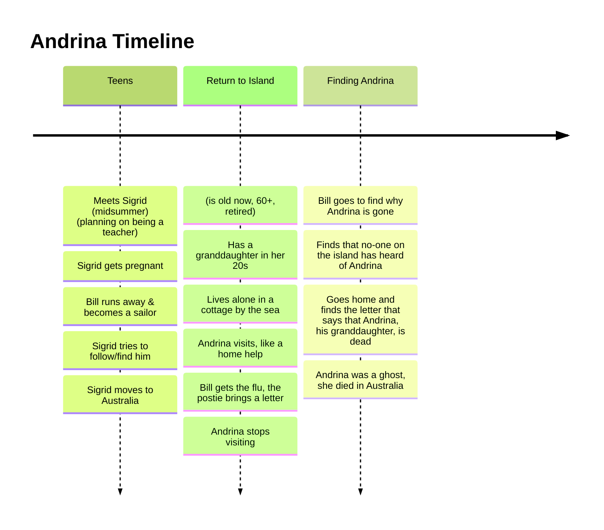

Equilibrium --> Disruption --> Search --> Flashback --> Revelation --> Resolution
1. Endearing, lonely, comfortable, simple, routine, hopeful, dull

#### Section 1: opening (lines 1-20)
Present tense: **Andrina** visits **Bill** daily
- She lights the fire

#### Section 1: Disruption
- Bill becomes seriously ill
- Andrina stops visiting
- Bill feels abandoned
- Quote:=="She did not come." (repeated)==

#### Section 2: Search for Answers
- Bill visits the village
- No one knows Andrina
- Tina Stewart:=="There was nobody of that name... in the island."==
- Mystery deepens

#### Section 2: Flashback
- Bill recalls his youthful romance with Sigrid
- Pregnancy --> shame --> abandonment
- Quote:=="He thrust her away... and ran up the beach."==

### Timeline

### Thoughts on Bill
Bill was a bad person, as he got Sigrid pregnant then ran away from his problems and responsibilities, not even stopping to think that Sigrid might be following him. He was trying to run away from the shame of pregnancy out of wedlock, but that still does not forgive what he has done.

---
- **Subject map:** [[English|English]]