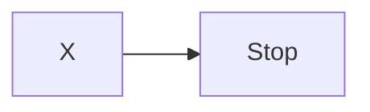
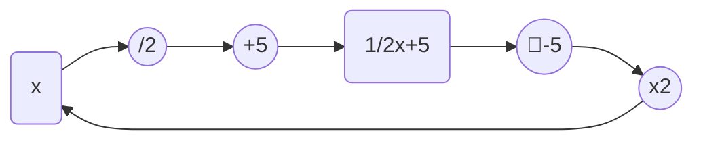

An **inverse function**, $f{^-1}(x)$, exists if there is a one-to-one correspondence between the domain and the range of $f$.
If that is true, the **domain** of $f$ is equal to the **range** of $f{^-1}$ and **vice versa**
(This builds on the idea of [[Set Notation|functions, domains and ranges]].)
### Example:
Find a formula for the inverse function of:
1. $f(x)=3x$.
   $f^{-1}(x)=\frac x3$ or $f^{-1}(x)=\frac 13x$ 


 2. $f(x)=\frac 12x+5$ 
**Function machine:**


**Change the subject:**
$f(f^{-1}(x))=\frac 12f^{-1}(x)+5$
$x=\frac12f^{-1}(x)+5$
$x-5=\frac12f^{-1}(x)$
$f^{-1}(x)=2(x-5)=2x-10$

 3. $f(x)=6-5x$
**Change the subject**
$f(f^{-1}(x))=6-5f^{-1}(x)$
$x-6=-5f^{-1}(x)$
$\frac{x-6}{-5}=f^{-1}(x)$


## Graphs of inverse functions
There are 2 ways to sketch the graph of inverse functions, from the graph of $f(x)$, or from the formula of $f^{-1}(x)$.

To draw a graph of $f(x)$ use (x,y) pairs
To draw a graph of $f^{-1}(x)$ use (y,x) pairs
To draw the graph of an inverse function, $f^{-1}(x)$, reflect the graph of f(x) in the line y=x

### Examples:
1. 
%% col-start %%

%% col-break:b:secondary %%

$f(x)=3x$
$f(1)=3$ (1,3)
$f(2)=6$ (2,6)
$f(3)=9$ (3,9)

%% col-break:b:secondary,t:blue %%

$f^{-1}(x)=x/3$
$f^{-1}(1)=3$ (3,1)
$f^{-1}(2)=6$ (6,2)
$f^{-1}(3)=9$ (9,3)

%% col-end %%

```desmos-graph
top=10.5; bottom=-2.5;
left=-2.5; right=7.5;
---
f(x)=3x|black
(1,3)|black|label:(1,3)
(2,6)|black|label:(2,6)
(3,9)|black|label:(3,9)

f(x)=x/3|blue|label:f^{-1}(x)
(3,1)|blue|label:(3,1)
(6,2)|blue|label:(6,2)
(9,3)|blue|label:(9,3)
```


---
- **Subject map:** [[Maths|Maths]]
