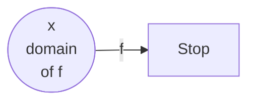
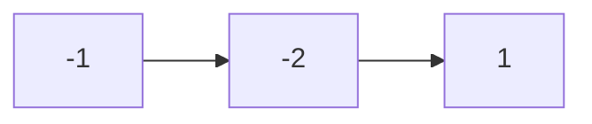

A **set** is a collection of objects (often numbers).
The **members** of a set are listed inside curly brackets, e.g; {1,2,3,4}
There are lots of symbols that are used with set notation:
$\in$ = is a member of, e.g; $\in$ {1,2,3,4} (\in)
$\notin$ = is not a member of.. (\notin)
; = such that
{} = empty set
$\subset$ = is a subset of (\subset)

---
There are also some common sets of numbers we will make use of:
$\mathbb{N}$ = Natural; {1,2,3,4,...}
$\mathbb{W}$ = Whole; {0,1,2,3,...}
$\mathbb{Z}$ = Integers; {...,-3,-2,-1,0,1,2,3,...}
$\mathbb{Q}$ = Rational numbers can be written as a fraction using integers/$\mathbb{Z}$
$\mathbb{R}$ = Real numbers are all numbers including irrational numbers e.g. $\sqrt2, \pi,...$
$\mathbb{C}$ = Complex numbers; these are not used at higher but they have no real answer e.g; <u>$x^2=-2$</u>

--- 
A set can be decribed in different ways, e.g;

P is the set of whole numbers beween 6 and 11 inclusive.
$$P=\{6,7,8,9,10,11\}$$
$$P=\{x\in\mathbb{N};6\leq x\leq11\}$$

---
## Functions and Mapping
A **function** is a relationship between **2 sets of numbers** such that each element of the first set, **the domain**, gives exactly one element in the second set, **the range**


We can represent a function in many different ways:
1) a statement: $x\to2x+3$ "x maps onto 2x+3"
2) a formula $f(x)=2x+3$
3) an arrow diagram

```mermaid
flowchart LR

id1([Domain]) id1([Range])


```
4) a set of ordered pairs {(-1,1),(0,3),(1,5),(2,7)}
5) a graph

Functions and their [[Inverse Functions|inverses]] swap the domain and range, so this set notation is the foundation for inverse functions.

### Examples:
1. For the function $f(x)=x^2-3$, $x\in\{-2,-1,0,1,2,3\}$
	a) Draw the arrow diagram


2. For the function$f(x)=\frac1{x-1}$, $\{x\in\mathbb{R}:2\leq x\leq6\}$ 
---
- **Subject map:** [[Maths|Maths]]
